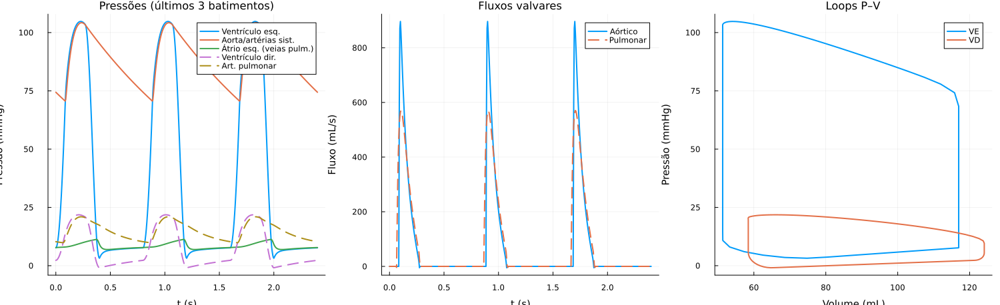
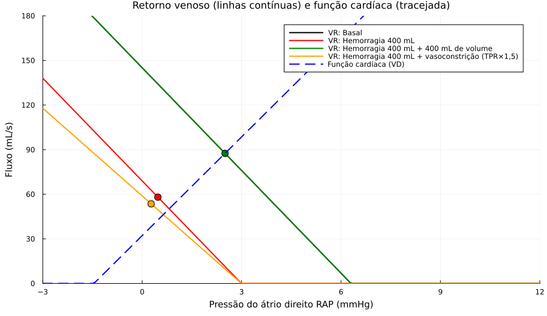
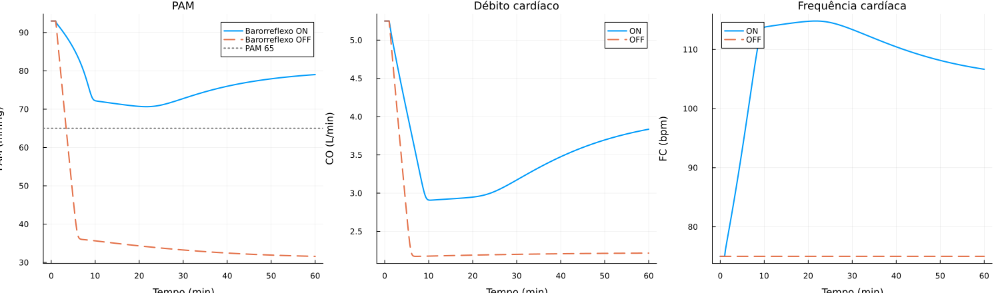
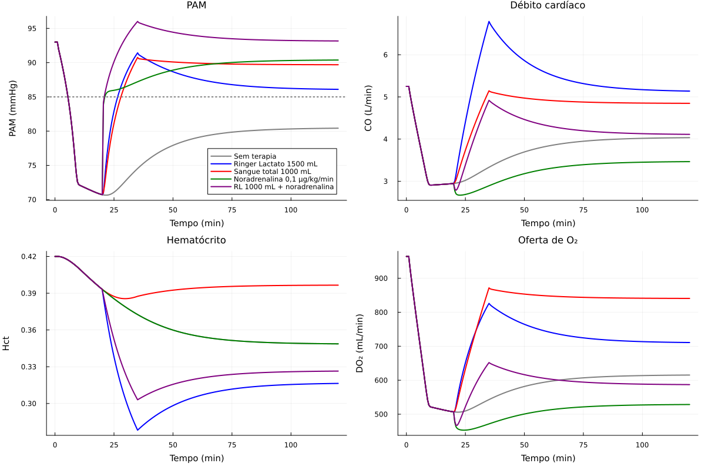
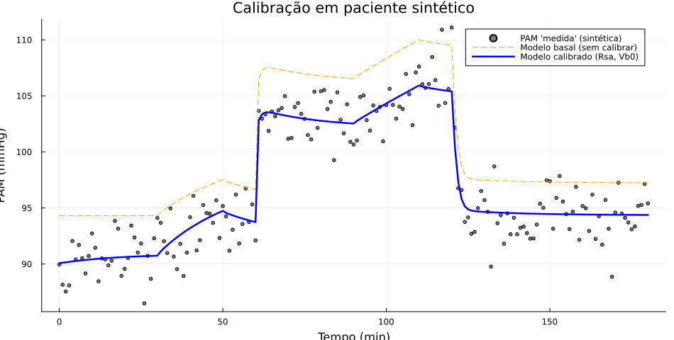

# Relatório de implementação — Modelo 0D em malha fechada (Frente A)

**Projeto:** PBL 2026.2 · Grupo 3 — *Modelagem 0D do sistema cardiovascular para simulação de choque hipovolêmico e comparação de terapias de reposição volêmica em UTI*
**Escopo deste relatório:** implementação em Julia do que foi especificado no [CLAUDE.md](../CLAUDE.md) (entregáveis A.2 e partes de B.3 e C.3).
**Estado:** o modelo roda, está verificado contra soluções analíticas (85 testes passando) e a calibração foi validada com **pacientes sintéticos**. **Nenhum dado real do MIMIC-IV foi usado**; portanto o modelo **ainda não está validado clinicamente**.

---

## 1. O que foi entregue

| Arquivo | Conteúdo |
|---|---|
| [src/params.jl](../src/params.jl) | `CircParams` (todos os parâmetros), `baseline_params` (projeto do basal por **alvos hemodinâmicos**), `with_params` |
| [src/physiology.jl](../src/physiology.jl) | elastância variável, válvula-diodo suave, colapso venoso, hematócrito/viscosidade, troca capilar, vasopressor, barorreflexo, `Scenario` |
| [src/mean_model.jl](../src/mean_model.jl) | modelo "lento" (valores médios, 4 volumes + 8 estados extras) e **ponto de funcionamento algébrico** |
| [src/closed_loop.jl](../src/closed_loop.jl) | modelo pulsátil em malha fechada (6 volumes + fase + 8 extras) |
| [src/analysis.jl](../src/analysis.jl) | métricas por ciclo, PV loop, curvas de Guyton e interseção |
| [src/data_io.jl](../src/data_io.jl) | leitura do esquema MIMIC-IV, grade regular, CSV processado, paciente sintético |
| [src/calibration.jl](../src/calibration.jl) | calibração (Optimization.jl), sensibilidade local, estado inicial compensado |
| [test/runtests.jl](../test/runtests.jl) | 85 testes (V1–V8 + fisiologia + dados) |
| [scripts/run_model.jl](../scripts/run_model.jl) | gera as figuras e [resultados.md](resultados.md) |
| [scripts/calibrate_synthetic.jl](../scripts/calibrate_synthetic.jl) | ensaio de calibração e [resultados_calibracao.md](resultados_calibracao.md) |

Só foram usados pacotes que **já estavam** no `Project.toml` (nenhuma dependência nova).

## 2. Como o modelo foi construído

Seguiu-se a sequência do CLAUDE.md, validando cada degrau antes do seguinte.

1. **Windkessel de 2 elementos** (já existia): `dPa/dt = [Q_in − (Pa−Pv)/R]/C`.
2. **Compartimentos** com relação P–V `P = (V − V₀)/C` (+ `P_th` nos intratorácicos). Estados são **volumes**, então hemorragia e infusão entram como fontes/sumidouros em mL/s.
3. **Coração como capacitor variável**: `P = E(t)·(V − V_d)`, `E(t) = E_min + (E_max − E_min)·e(t)` com ativação em cosseno; válvulas como `Q = (ΔP/R)·σ(k·ΔP)`.
4. **Malha fechada**: VE → artérias sist. → veias sist. → VD → artérias pulm. → veias pulm. → VE. `Rsv` fica em série com a tricúspide.
5. **Dois modelos de coração com a mesma física**:
   - *pulsátil* (PV loops, formas de onda; ~3 s por simulação de 40 s);
   - *lento* (`SV = C_D·(P_f − P_th) − C_S·(P_pós − P_th)`), usado para horas de UTI e calibração.
6. **Basal projetado por alvos** (`baseline_params`): resistências por Ohm, `C_D`/`C_S` a partir de EDV/ESV, volumes a partir das pressões. O modelo lento reproduz **exatamente** PAM 93, CVP 5, RAP 2,5, PAP 15, PAE 8 mmHg e CO 5,25 L/min.
7. **Sangue e fluidos**: estados de volume de hemácias (`Hct = V_rbc/V_sangue`) e de líquido intersticial; só o excesso de **plasma** é filtrado (hemácias não), com refil saturável; `R ∝ μ(Hct)/μ(Hct_ref)` nas resistências sistêmica e pulmonar.
8. **Vasopressor**: efeito Emax com compartimento de efeito (τ = 60 s) atuando em `TPR`, `V₀` venoso e contratilidade.
9. **Barorreflexo**: PAM filtrada → sigmoide → efetores de 1ª ordem (FC, TPR, V₀ venoso, contratilidade). Pode ser desligado por cenário.
10. **Dados**: tabelas no esquema do MIMIC-IV → grade de 60 s (volumes distribuídos por sobreposição, **conservando o total**) → funções do tempo → `Scenario`. A FC medida entra como **forçante** (`hr_forced`).

## 3. Verificação (CLAUDE.md §9)

Todos os testes passam (`julia --project=. test/runtests.jl`, ~25 s).

| # | Verificação | Resultado |
|---|---|---|
| V1 | τ ajustado na diástole do Windkessel = R·C | erro < 1 % ✅ |
| V2 | Conservação de volume (com troca capilar; modelos lento e pulsátil) | resíduo < 1e-3 mL / 0,5 mL ✅ |
| V3 | Coração parado ⇒ pressões sistêmicas → `Pms` (E8) | erro < 0,05 mmHg ✅ |
| V4 | Ventrículo isolado: `SV = C_D·P_f − C_S·P_a` (E13) | erro < 5 % ✅ |
| V5 | Ponto de funcionamento: EDO × algébrico × interseção de Guyton | PAM < 0,1 mmHg; CO < 1 %; RAP < 0,1 mmHg ✅ |
| V6 | Pulsátil × lento | PAM < 6 mmHg, CO < 10 % ✅ (ver §5) |
| V7 | Convergência (reltol 1e-6 × 1e-9) | PAM < 0,01 mmHg ✅ |
| V8 | Faixas fisiológicas do basal | PAM, PAS/PAD, CO, SV, FEVE, PVC dentro da faixa ✅ |

Testes de fisiologia (qualitativos, direção esperada): hemorragia derruba a PAM; o barorreflexo a sustenta e causa taquicardia; RL dilui o Hct e sangue total não; sangue total entrega mais O₂; RL vaza mais para o interstício; o vasopressor eleva a PAM. Testes de dados: leitura do esquema MIMIC (volumes conservados, *forward-fill*), ida e volta pelo CSV, reprodutibilidade do paciente sintético.

## 4. Resultados

### 4.1 Basal pulsátil

| Variável | Pulsátil | Alvo (modelo lento) |
|---|---|---|
| PAM (mmHg) | 88,2 | 93,0 |
| PAS/PAD (mmHg) | 104/71 | — |
| CO (L/min) | 4,93 | 5,25 |
| SV (mL) | 65,8 | 70,0 |
| EDV/ESV do VE (mL) | 117/51 | 120/50 |
| FEVE | 0,56 | 0,58 |
| PVC média (mmHg) | 5,7 | 5,0 |



### 4.2 Curvas de Guyton

Hemorragia de 400 mL: `Pms` 6,30 → 2,99 mmHg; o ponto de funcionamento vai de (RAP 2,50; CO 5,25) para (0,47; 3,48 L/min). Repor o volume devolve o ponto basal. Aumentar o TPR em 50 % gira a curva de retorno venoso e **piora** o CO (3,21 L/min) — o argumento do abstract contra a "vasoconstrição excessiva".



### 4.3 Hemorragia e compensação (classe III: 1500 mL em 10 min)

| | PAM mín (mmHg) | CO mín (L/min) | FC máx (bpm) |
|---|---|---|---|
| Barorreflexo desligado | 32 | 2,17 | 75 |
| Barorreflexo ligado | 71 | 2,91 | 115 |



### 4.4 Comparação de terapias (hemorragia de 1500 mL; infusão em t = 20 min, 15 min de duração)

| Terapia | Min até PAM ≥ 85 | PAM 100 min | CO 100 min | Hct 100 min | DO₂ 100 min (mL/min) | Intersticial 100 min (mL) |
|---|---|---|---|---|---|---|
| Sem terapia | não atinge | 80 | 4,02 | 0,349 | 614 | −649 |
| Ringer Lactato 1500 mL | 7,0 | 86 | 5,17 | 0,316 | 714 | +450 |
| Sangue total 1000 mL | 8,0 | 90 | 4,85 | 0,396 | 841 | −210 |
| Noradrenalina 0,1 µg/kg/min | 1,5 | 90 | 3,45 | 0,349 | 527 | −649 |
| RL 1000 mL + noradrenalina | 1,0 | 93 | 4,13 | 0,326 | 588 | +83 |

Leitura (**qualitativa**, dependente de parâmetros ainda não calibrados):
- O RL repõe o CO mais depressa, mas **dilui** (Hct 0,32), **vaza** (450 mL no interstício) e entrega menos O₂ que o sangue total.
- O sangue total mantém Hct e viscosidade e dá a maior oferta de O₂.
- A noradrenalina isolada sobe a PAM rápido, mas com **CO e DO₂ os mais baixos** (527 mL/min, abaixo até de não tratar): a pressão "melhora" sem perfusão.



### 4.5 Calibração em paciente sintético

Verdade: `Rsa = 1,257`, `Vb0 = 3965 mL`, `EmaxL = 2,21`; PAM a cada minuto por 3 h, ruído de 2 mmHg.

| Parâmetros ajustados | λ | RMSE (mmHg) | erro relativo |
|---|---|---|---|
| `Rsa`, `Vb0` | 0 | 1,85 | −0,8 % / −0,8 % |
| `Rsa`, `Vb0`, `EmaxL` | 0 | 1,85 | −14 % / −1 % / **+132 000 %** |
| `Rsa`, `Vb0`, `EmaxL` | 0,5 | 1,86 | −10 % / +2 % / +23 % |

Sem calibrar, o RMSE é 3,94 mmHg. O RMSE do ajuste (1,85) fica no nível do ruído (2,0), isto é, o modelo explica os dados. **Mas a PAM sozinha não identifica `EmaxL`** (sensibilidade média 0,015 contra 0,37 de `Vb0`): o ajuste "funciona" com um valor absurdo. É o alerta de Nucci & Cobelli sobre identificabilidade, na prática.



## 5. Problemas encontrados e decisões

| Problema | Causa | Solução |
|---|---|---|
| `Rodas5P` abortava no 1º passo (NaN) | `mod(φ,1)` tem derivada NaN em φ inteiro (diferenciação automática do Jacobiano) | fase `φ − floor(φ)` (e no teste do ventrículo isolado) |
| Hemorragia deixava a pressão venosa muito negativa | relação P–V linear não tem colapso | softplus (`sveno = 0,25 mmHg`): `P → 0` com a veia colapsada |
| Guyton (E10) divergia do equilíbrio em hemorragias grandes | E10 assume vasos lineares; com veia colapsada deixa de valer | testado no regime linear (400 mL); para 700 mL a EDO é comparada ao equilíbrio **algébrico** |
| Pulsátil 5 mmHg abaixo do alvo | ESV define-se na pressão de fim de sístole e o enchimento do VD não é instantâneo (R·C ≈ 0,5 s) | compensado no modelo lento por `dPesL/dPesR`; diferença documentada (V6) |
| Calibração com 3 parâmetros divergia | `EmaxL` não identificável pela PAM | calibrar 2 parâmetros ou regularizar (λ), nunca `EmaxL` só com PAM |
| `missingstrings` do CSV.jl | API mudou (`missingstring`) | corrigido |

## 6. Limitações (leia antes de usar os números)

1. **Sem validação com dados reais.** Todas as conclusões de §4.4 são do modelo com parâmetros de literatura/ordem de grandeza; o projeto só ganha credibilidade (V&V 40, Pruett et al. 2020) após a calibração com o MIMIC-IV e a validação em dados independentes.
2. **Classes III e IV de hemorragia dão o mesmo resultado** (PAM ≈ 70, CO ≈ 2,95): o modelo chega ao platô de retorno venoso (veia colapsada, barorreflexo saturado) e **não representa a descompensação** (perda de tônus, isquemia). Não use para prever colapso além da classe III.
3. **Efeito do PEEP exagerado**: o script transmite toda a variação de `P_th` ao coração (`P_th` de −4 para +3,7 mmHg derruba o CO em 65 %). Na realidade só uma fração da pressão de via aérea chega à pleura. Requer um fator de transmissão antes de uso quantitativo.
4. **Cristaloide em nível 1** (exchange linear com saturação no refil); a versão de Starling (pressão oncótica) do CLAUDE.md §7.2 **não** foi implementada.
5. Fluxo aórtico de pico ~900 mL/s (acima do fisiológico ~500): a ejeção é rápida demais; afeta a forma de onda, não as médias.
6. Sem átrios ativos, sem acoplamento ventricular, sem regulação renal/hormonal.
7. Viscosidade ainda é o **placeholder** `μ = μ_pl·exp(2,5·Hct)` (entregável B.2 da Frente B). Há uma alternativa de Krieger–Dougherty (`blood_viscosity_krieger`), ainda não usada.
8. A calibração usa **Nelder–Mead** em `log θ` com sensibilidade por diferenças finitas, e não gradientes adjuntos (`SciMLSensitivity`), porque são poucos parâmetros. Fica como evolução.
9. **ModelingToolkit não foi usado**: o modelo foi escrito "à mão" (decisão do CLAUDE.md §13.3: primeiro à mão, depois migrar usando-o como gabarito). A migração está pendente.

## 7. Pendências para integrar o MIMIC-IV

1. **Conferir os `itemid`** em [`MIMIC_ITEMIDS`](../src/data_io.jl) contra `d_items`/`d_labitems` da versão instalada (os códigos foram escritos de memória e **não** foram verificados com a base).
2. O `labevents` não tem `stay_id`: filtrar por `hadm_id` e janela da UTI antes de chamar `build_patient`.
3. "Sangue total" quase não existe no MIMIC: o pipeline usa concentrado de hemácias (PRBC) com `hct_blood = 0,40`; para PRBC o hematócrito real é ~0,55–0,65 e deve ser ajustado.
4. Hemorragia não é observada: ela entra pelo **volume inicial efetivo `Vb0`**, um parâmetro estimado por paciente.
5. Definir a coorte e os critérios de exclusão (Frente C), e a tabela de parâmetros com fontes (Frente B), para substituir os valores iniciais do `baseline_params`.
6. Os dados do MIMIC têm termo de uso da PhysioNet: `data/raw/` e `data/processed/` estão no `.gitignore` e **não devem ser publicados**.

## 8. Como reproduzir

```bash
julia --project=. test/runtests.jl              # 85 testes, ~25 s
julia --project=. scripts/run_model.jl          # figuras 01–05 e docs/resultados.md, ~15 s
julia --project=. scripts/calibrate_synthetic.jl  # figura 06 e docs/resultados_calibracao.md, ~6 min
```

Uso mínimo no REPL:

```julia
push!(LOAD_PATH, "src"); using Cardio0D
p  = baseline_params()                                  # adulto ~70 kg
sc = Scenario(Qhem = window_rate(1500, 60, 600),        # 1500 mL em 10 min
              Qinf = window_rate(1000, 1200, 900), hct_inf = 0.40,
              tstops = [60.0, 660.0, 1200.0, 2100.0])
sol = simulate_mean(p, sc, (0.0, 7200.0))
obs = mean_observables(sol, p, sc, 0:60:7200)           # PAM, CO, FC, Hct, DO₂ ...
```
